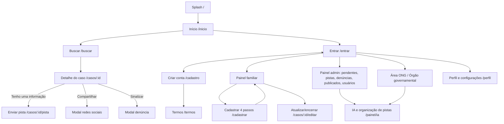

# Reencontro — plataforma de apoio à localização de pessoas desaparecidas

Monorepo: `backend/` (NestJS + TypeORM + SQLite + JWT) e `frontend/` (React + Vite + TypeScript, mobile-first).

## Estrutura (projetos separados)
- `backend/`: API NestJS. Veja `backend/README.md` (banco local/nuvem, armazenamento local/S3, Gemini).
- `frontend/`: app React. Veja `frontend/README.md`.
Cada pasta tem seu próprio `package.json`, `.env.example` e pode ir para um repositório e uma hospedagem diferentes.

## Como rodar
```bash
cd backend  && cp .env.example .env && npm install && npm run start:dev   # porta 3000
cd frontend && cp .env.example .env && npm install && npm run dev         # porta 5173
```
Contas demo: admin@reencontro.app / Admin@12345 · familiar@demo.app · cidadao@demo.app · ong@demo.app · orgao@demo.app (senha Demo@12345).

## Fluxo de páginas


## Telas (React)
Splash · Início (hero, busca, casos, “Como enviar pistas”, indicadores) · Como ajudar e segurança · Instituições parceiras · Notificações · Auditoria (admin) · · Buscar pessoas (filtros) · Detalhe do caso · Cadastrar desaparecimento (4 passos + confirmação) · Enviar pista · Login · Criar conta · Termos/LGPD · Painel do familiar (com legenda de estados) · Atualizar/encerrar caso · Painel administrativo · Área de ONGs · Órgãos governamentais · IA e organização de pistas · Perfil e configurações (dados, permissões, senha, acessibilidade) · Menu lateral.

## Rastreabilidade dos requisitos
| Requisito | Onde está |
|---|---|
| RF Cadastrar pessoa desaparecida | `POST /cases`, `CaseWizard.tsx` |
| RF Consultar/buscar | `GET /cases` (nome, região, idade, data, situação), `Search.tsx` |
| RF Atualizar/encerrar caso | `PATCH /cases/:id`, `POST /cases/:id/located`, `EditCase.tsx` |
| RF Enviar pistas | `POST /cases/:id/tips`, `SendTip.tsx` |
| RF Compartilhar em redes | `POST /cases/:id/share` (WhatsApp, Facebook, X, Telegram, Instagram/link) |
| RF Área de ONGs | `/organizations/*`, `OrgPanel.tsx` |
| RF Área governamental | idem + comunicações e log de acessos |
| RF IA | `AiService` (compatibilidade, alerta de prioridade, duplicidades), `AiPage.tsx` |
| RF Segurança e moderação | verificação prévia, denúncias, bloqueio, validações, upload restrito |
| RNF LGPD | contato/responsável só para dono, ONG, órgão e admin; termos no cadastro |
| RNF acessibilidade | foco visível, aria, texto maior e alto contraste |
| RNF simultaneidade | API stateless (JWT); trocar SQLite por Postgres em produção |
| RN Verificação antes de publicar | `AGUARDANDO_ANALISE → PUBLICADO/REJEITADO` (`PATCH /admin/cases/:id/review`) |
| RN Prioridade (menores/vulneráveis) | `urgent` calculado no backend; ordenação e selo "Prioritário" |
| RN Compartilhar só com autorização | `shareAuthorized` validado no backend |
| RN Pista nunca "confirmada" sem análise | status `EM_ANALISE` até revisão humana |
| RN Histórico de atualizações | `case_updates`, exibido no detalhe |
| RN Localizada sai da lista ativa | busca padrão só `PUBLICADO` |
| RN Permissões por perfil | `RolesGuard` + `@Roles()` |
| RN Remoção/bloqueio só admin | `DELETE /admin/cases/:id`, `PATCH /admin/users/:id` |

## Principais endpoints (prefixo `/api`)
`POST /auth/register|login` · `GET|PATCH /auth/me` · `PATCH /auth/password` · `GET /cases` · `GET /cases/mine` · `GET|PATCH /cases/:id` · `GET /cases/:id/updates` · `POST /cases` · `POST /cases/:id/located|share|report|tips` · `PATCH /cases/:id/share-authorization` · `GET /tips`, `/tips/mine` · `PATCH /tips/:id/review` · `GET /admin/overview|cases|users|reports|organizations` · `PATCH /admin/cases/:id/review` · `POST /admin/cases/:id/forward` · `GET /organizations/dashboard|cases|communications|duplicates` · `POST /organizations/communications` · `POST /uploads`.

## Responsividade
Breakpoints 640 px (tablet) e 960 px (computador). No celular: cabeçalho + menu inferior + drawer; no computador: barra superior com links e ações, grades de 2 a 3 colunas, detalhe do caso em duas colunas.

## Pontos para evoluir
- Recuperação/redefinição de senha e verificação de e-mail (exigem serviço de e-mail).
- Telas ainda não feitas do documento Figma: gestão de membros de ONG/órgão, relatórios, comparação lado a lado de pistas e histórico de decisões da IA.
- Trocar `synchronize: true` por migrations e SQLite por PostgreSQL.
- Rate limit (`@nestjs/throttler`) e validação de conteúdo de imagem.
- Substituir a IA heurística por um modelo/serviço externo mantendo a revisão humana.
- Notificações (e-mail/push) para familiares quando chegam pistas.
